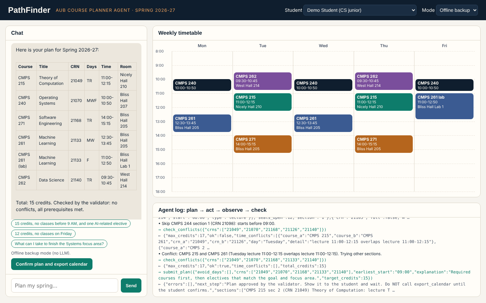

# PathFinder: an AI agent that plans your AUB semester

**Team:** Rayane Dhaini · Lana El Labban · Ghina Al Feel
**Event:** CS Student Society × Helix Agentic AI Competition, Nov 18, 2026

PathFinder plans your semester for you. It reads your AUB record, checks prerequisites with AUB's
real grade rules (like the C+ in CMPS 202), searches sections, fixes time conflicts by itself,
and hands you a timetable plus a calendar file. It never registers you: you confirm and register on AUBsis.



## How it works

```
Goal ─► Plan ─► Act (call a tool) ─► Observe (read result) ─► Check (validator)
          ▲                                                        │
          └──────────────── not valid? fix and try again ◄─────────┘
```

| Tool | What it does |
|---|---|
| `get_student_record` | Courses taken, grades, standing, remaining requirements, AUB alerts |
| `search_courses` | Search the CMPS catalogue by text, tag or focus area |
| `check_prerequisites` | Can the student take it? With the exact reason |
| `find_sections` | Sections with CRN, days (M T W R F), times, rooms, open seats |
| `check_conflicts` | Time overlaps (lectures and labs) and total credits |
| `submit_plan` | Sends the plan to the **validator**; errors must be fixed |
| `export_calendar` | Writes an `.ics` file, **only after the student confirms** |

### What makes it AUB-specific
- Real course codes, titles, credits and prerequisites from the **AUB Undergraduate Catalogue 2025-26** (Department of Computer Science).
- AUB grade rules: at least **C+ in CMPS 201/202** to unlock most CMPS courses, and it suggests repeating CMPS 202 when needed.
- **CMPS 260 and CMPS 269 don't count as CMPS electives** for CS majors. The agent warns you.
- The three **focus areas**: Systems, AI and Data Science, Software Engineering.
- Senior standing for CMPS 243, the CMPS 251 corequisite for CMPS 254, AUB day letters (R = Thursday), CRNs, AUBsis.

### Reliability and safety
- **Grounded:** it can only use courses and CRNs from the data files. Invented CRNs are rejected.
- **Validator:** every plan is checked (prerequisites, seats, conflicts, credit limit, the student's constraints).
- **Errors don't crash it:** a failing tool returns an error message to the model, which tries something else.
- **Step limit:** max 20 steps, so it can't loop forever.
- **Human in control:** `export_calendar` is locked until the student clicks Confirm. It never registers anyone.
- **Keys:** API keys live in `.env`, which git ignores.

## Run it

```bash
git clone https://github.com/rayane-019/pathfinder.git
cd pathfinder
python -m venv .venv
source .venv/bin/activate            # Windows: .venv\Scripts\activate
pip install -r requirements.txt

cp .env.example .env                 # Windows: copy .env.example .env
# open .env and paste your API key (free Gemini key: https://aistudio.google.com/apikey)

python web/app.py                    # web demo -> http://127.0.0.1:5000
python main.py                       # terminal demo
python main.py --offline             # backup: no API key, no internet needed
python -m pytest -q                  # tests
```

Demo request: *"I'm a CS junior. Plan my spring with 15 credits, no classes before 9 AM, and one AI-related elective."*

## Project structure

```
data/courses.json        AUB CMPS catalogue (real)                 Lana
data/sections.json       Spring sections (SAMPLE, made up)          Lana
data/students.json       Two fictional demo students                Lana
data/rules.json          Grade scale, focus areas, term, limits     Lana
pathfinder/data.py       Loads the data                             Lana
pathfinder/prereqs.py    Prerequisite checker                       Lana
pathfinder/tools.py      The 7 tools + their schemas for the LLM    Lana
pathfinder/schedule.py   Times and conflict detection               Ghina
pathfinder/validator.py  The plan validator                         Ghina
pathfinder/calendar_export.py  .ics export                          Ghina
web/                     Web demo (chat, timetable, live log)       Ghina
pathfinder/llm.py        LLM connection                             Rayane
pathfinder/agent.py      The agent loop + system prompt             Rayane
pathfinder/offline.py    Backup planner without an LLM              Rayane
main.py                  Terminal demo                              Rayane
tests/                   Tests for every part                       All
```

## Honest limits
- Course titles, credits and prerequisites come from the AUB catalogue. **Section times, rooms, seats and CRNs are sample data.**
- The credit limit (17), standing thresholds and term dates in `data/rules.json` are demo settings. Check the official AUB sources.
- The demo students are fictional. Never commit real student records.
